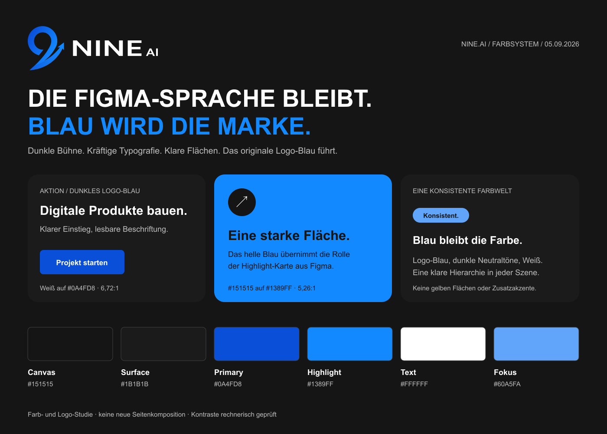

# Nine.ai — Designsprache und Markenadaption

Stand: 06.09.2026 · Aktuelle Richtung: verständliche Angebote und kurze Wege zum passenden Paket.

**Neue verbindliche Nutzerentscheidung:** Die bisherige Seite ist zu abstrakt und zu lang; normale Besucher sollen sofort verstehen, was Nine.ai anbietet. Die Pakete müssen deutlich früher erreichbar sein. Der Nutzer erlaubt ausdrücklich eine freie Neugestaltung. Damit entfällt die frühere Bindung an die Figma-Komposition. **Das Logo-Blau bleibt; Gelb bleibt ausgeschlossen.**

**Für die aktuelle Umsetzung ist Abschnitt 22 maßgeblich.** Abschnitte 1–19 dokumentieren die historische Figma-Analyse und vorangegangene Implementierung. Ihre Forderung nach Kompositionstreue wird durch die neue Nutzerentscheidung ersetzt. Inhaltliche Korrektheit, technische Qualität und die dokumentierten blauen Farbrollen gelten weiter.



## 1. Auftrag, Quellen und Verbindlichkeit

Die Nutzerentscheidung lautet: Figma-Design mit Nine.ai-Inhalten, möglichst identische visuelle Umsetzung. Die anschließende Korrektur hat ausdrücklich klargestellt, dass eine freie Interpretation nicht genügt. Neu hinzugekommen sind das originale Logo und der Wunsch, sein Blau als Hauptfarbe, mindestens aber als sichtbare Sekundärfarbe zu verwenden.

| Quelle | Rolle |
| --- | --- |
| [Figma Desktop, 13:1778](https://www.figma.com/design/I1DDy6LJNQgwdp6gEkIc8b?node-id=13-1778) | Komposition, Proportionen, Typografie, grafische Elemente, Desktop-Anordnung |
| [Figma Mobil, 27:187](https://www.figma.com/design/I1DDy6LJNQgwdp6gEkIc8b?node-id=27-187) | Eigenständige Mobilkomposition; keine verkleinerte Desktopseite |
| `Nine.ai_Website-Masterplan.docx` | Positionierung und fachliche Inhalte; Preis- und Leistungsmodelle teilweise Vorschläge |
| `Nine.ai_Design-Handbuch.docx` | Ergänzende Qualitätsanforderungen, Inhaltswahrheit, Formulare und Barrierefreiheit |
| [NineAI-original.svg](public/assets/brand/NineAI-original.svg) | Originale Bild-/Wortmarke, Kurven, Verhältnis und blaue Verläufe |
| Aktueller Quellcode | Implementierungsstand; ausdrücklich kein Ersatz für die Figma-Referenz |

Die Dokumente enthalten Empfehlungen, keine eigenständigen Nutzeraufträge. Ihre alternative helle Gestaltung mit Instrument Sans, IBM Plex Mono, `#244BDB` und 3×3-Punktmotiv ist **nicht** die gewählte Figma-Richtung. Sie wird nicht stillschweigend wieder eingeführt. Das echte Logo ersetzt auch die frühere selbst gesetzte Wortmarke `nine.ai`.

In diesem Dokument bedeutet **Referenz**: direkt aus den Figma-Ansichten oder dem SVG festgestellt. **Ableitung**: erklärende gestalterische Interpretation. **Festlegung**: empfohlene Regel für Nine.ai, wo Referenz oder Nutzerwunsch eine Anpassung erfordern. **Offen**: nicht belegter oder noch zu prüfender Punkt.

„Vollständig verstehen“ heißt hier: die wesentlichen Gestaltungsentscheidungen und ihre Abhängigkeiten explizit beschreiben. Eine statische Figma-Datei beweist weder Interaktionszustände noch Browser-Parität. Diese Grenzen werden nicht als vermeintliche 100-%-Gewissheit ausgegeben.

## 2. Die visuelle Idee

Die Vorlage ist eine selbstbewusste, plakative Studioseite auf nahezu schwarzem Grund. Ihre Wirkung entsteht aus dem Wechsel zwischen sehr dichter, schwerer Typografie und großen freien Flächen. Der großzügige vertikale Abstand lässt jeden Abschnitt wie eine eigene Szene wirken. Große Fotos und farbige Felder unterbrechen die gleichmäßige Dunkelheit.

Drei wiederkehrende Gegensätze prägen die Gestaltung:

- **Strenges Raster und gezielte Ausbrüche:** Text und Karten folgen festen Kanten; Fotos laufen zum Bildschirmrand, Bänder kreuzen sich und Dekorationen werden am Rand angeschnitten.
- **Schwere Schrift und leichte Zeichnung:** Massive Versalien stehen neben dünnen Konturen, feinen Umlaufkreisen und gezeichneten Flugspuren.
- **Ruhige Bildwelt und aktive Farbe:** Schwarz-Weiß-Fotografie stabilisiert die Seite; gesättigte Akzentflächen lenken den Blick.

Der Stil ist nicht allein „Dark Mode + Akzentfarbe“. Sechs Dinge müssen gemeinsam bestehen bleiben: Cabinet Grotesk Black, enge Headline-Zeilen, klar getrennte Szenen, asymmetrische Bildkanten, runde Aktionszeichen und der Wechsel zwischen dunklen und farbigen Flächen.

Die Markenadaption mit Blau bleibt plausibel, weil das Logo ebenfalls klare Geometrie mit einer gerichteten Bewegung verbindet. Die Pfeilkurve liefert einen eigenen Bezug zu Entwicklung und Wachstum. Zusätzliche futuristische Effekte sind dafür nicht nötig.

## 3. Unveränderlicher Kern und erlaubte Anpassungen

| Ebene | Bleibt erhalten | Darf sich für Nine.ai ändern |
| --- | --- | --- |
| Komposition | Reihenfolge, sechs Leistungskarten, drei Projektkarten, zwei Bildraster, Prozess und Porträtkomposition | Keine neue Rasterstruktur ohne ausdrücklichen Auftrag |
| Typografie | Cabinet Grotesk, Gewichtshierarchie, Versalien, Größen und Zeilenrhythmus | Redaktioneller Text, passend zu den Textflächen |
| Farbe | Dunkle neutrale Basis, dominante Akzentflächen, klare Hell-Dunkel-Kontraste | Gelbe Aktions-/Highlight-Rollen werden blau |
| Marke | Position und optische Balance des Logos | Echte Bild-/Wortmarke statt Template- oder Ersatzlogo |
| Bilder | Format, Ausschnittsabsicht, Flächengewicht, Graustufen bei Studiofotos | Freigegebene Nine.ai-Motive anstelle von Templatebildern |
| Interaktion | Bestehende Navigations- und Inhaltsaufgaben | Funktionierende Zustände, Tastaturbedienung und Beschriftungen |
| Belege | Visuelle Rolle der Beweisführung | Nur tatsächliche Kunden, Partner, Personen, Zahlen und Zitate |

Ein Markenwechsel kann nicht gleichzeitig bitgenau dieselben Pixel wie das gelbe Template besitzen. Das Ziel ist **Kompositions- und Komponenten-Treue mit expliziter Markenadaption**. Änderungen müssen einer der rechten Spalten entsprechen und dürfen nicht als unbemerkter Layoutumbau auftreten.

## 4. Seitenarchitektur: Desktop

Referenzframe: **1440 × 6431 px**. Zentraler Inhaltsbereich: **1240 px**, Außenabstand **100 px**. Die folgenden Y-Werte sind Messwerte dieser konkreten Vorlage, keine allgemeine Anweisung zur absoluten Positionierung.

| Abschnitt | Y | Höhe / zentrale Geometrie | Gestalterische Funktion |
| --- | ---: | --- | --- |
| Navigation | 51 | 1240 × 56 | Leichter horizontaler Auftakt, Logo links, Aktion rechts |
| Hero-Text | 222 | Headline 64/60, Begleittext 400 px breit | Angebot schlagartig verständlich machen |
| Hero-Foto | 505 | 920 × 522, links randbündig | Menschliche Bildwelt als großes Gegengewicht zur Schrift |
| Kennzahlensäule | neben Foto | Drei Blöcke mit horizontalen Trennlinien | Rhythmus und Belegstruktur auf der rechten Seite |
| Kreuzbänder | 1167 | ungefähr 214 px Gesamtregion | Erster dynamischer Bruch im horizontalen Raster |
| Leistungen | 1521 | 778 px, sechs Karten in 3×2 | Angebot in gleichwertigen Feldern erfassbar machen |
| Projekte | 2439 | 694 px; farbiger Hintergrund 428 px hoch | Breiter Farbumschlag und bildstarke Produktbeispiele |
| Marken-/Toolzeilen | 3273 | 346 px | Abgerundete Einzelmarken als lockerer Gegenrhythmus |
| Prozess | 3759 | 522 px; Foto 710 × 522 rechts | Vier nachvollziehbare Schritte plus großes Bild |
| Erstes Bildraster | 4421 | 476 px; vier Karten 295 × 318 | Kategorien, Bildinhalte und Details zusammenführen |
| Porträts/Aussage | 5037 | 533 px | Zentrierter Auftakt, darunter Bild links und Aussage rechts |
| Zweites Bildraster | 5710 | 476 px; vier Karten 295 × 318 | Zweiter redaktioneller Überblick in gleicher Grammatik |
| Footer | 6326 | 105 px | Ruhiger, kompakter Abschluss auf leicht hellerer Fläche |

Ab dem Leistungsabschnitt wiederholt sich zwischen großen Szenen häufig **140 px Abstand**. Diese Wiederholung ist ein wesentliches Merkmal. Kleinere Innenabstände ersetzen diesen Szenenabstand nicht.

### Wichtige Asymmetrien

Das Hero-Foto endet bei x=920; es sitzt nicht einfach in einer symmetrischen 50/50-Spalte. Rechts bleiben die drei Belegblöcke sichtbar. Der Prozess kehrt die Richtung um: Text links, ein großes Bild bis an den rechten Rand. Diese Richtungswechsel halten die lange Seite lebendig.

Die Hero-Headline hat in den exportierten Figma-Daten eine breite Textbox von 882 px. Diese Bounding Box ist nicht als unabhängige CSS-Spalte plus Begleittext zu addieren. Tatsächliche Glyphenbreite, manuelle Umbrüche und der Begleittext ab etwa x=940 müssen zusammen geprüft werden. Der aktuelle Code verwendet dafür eine 800/400-Aufteilung mit 40 px Zwischenraum; das ist eine Implementierungsentscheidung, kein unveränderter Figma-Wert.

## 5. Mobilkomposition und Zwischenbreiten

Referenzframe: **390 × 9896 px**. Normale Inhaltsbreite **358 px**, seitlich **16 px**. Randbilder verwenden teilweise **374 px**. Ein vollständiger zweiter Frame ist eine eigenständige Komposition und keine skalierte Desktopzeichnung.

| Element | Mobiles Referenzverhalten |
| --- | --- |
| Navigation | Logo links, dreizeiliges Menü rechts; keine volle Linkleiste |
| Hero | Zentriert, beginnt etwa y=127; H1 32/32; Begleittext 14/20; Aktion 133 × 48 |
| Hero-Foto | Ab y=422, 374 × 212, links randbündig; rechte Radien rund 16 px |
| Explore-Marke | 53 × 53, überlappt den oberen Bildrand |
| Kennzahlen | Drei nebeneinander statt einer vertikalen Säule; 32/40 mit 14/20 Labels |
| Kreuzbänder | Stark verkleinert und beschnitten, kein vollständig lesbares Logoverzeichnis |
| Leistungen | Sechs Karten untereinander, 358 × 300, 16 px Zwischenraum |
| Projekte | Eine Hauptkarte 334 × 468; Nachbarkarte im Original am Rand angeschnitten; Navigation darunter |
| Toolzeilen | Zwei kompakte, horizontal beschnittene Reihen |
| Prozess | Überschrift, vertikale Schritte, danach randnahes Foto rechts; Bild 374 × 275 |
| Bildraster | Eine Spalte; Bilder 358 × 241, Fuß 77 px, Kartenabstand 24 px |
| Alle-ansehen-Link | In der Mobilvorlage nach der Kartenliste, nicht ersatzlos entfernt |
| Aussagen | Porträtbild über Text, Navigation danach |
| Footer | Hochformatblock ungefähr 407 px; Links gruppiert, Logo und Copyright getrennt |

Weitere markante Referenzanker: erste Servicekarte y=1161; Projektüberschrift y=3232; Projektkarte y=3423; Prozessüberschrift y=4357; Prozessfoto y=4861; erstes Raster Heading y=5236 und Bildstart y=5424; Aussage-Heading y=6984; zweites Raster Heading y=7795.

Für 768, 1024 und 1280 px gibt es in den beiden bereitgestellten Frames keine vollständige, separat verifizierte Designvorgabe. Die Zwischenzustände müssen aus den Layoutaufgaben abgeleitet und geprüft werden. Der Wechsel von drei auf zwei auf eine Service-Spalte ist plausibel, aber eine Ableitung.

**Reflow-Regel:** Referenzhöhen gelten bei Referenzbreite und Referenztext. Bei 200 % Textvergrößerung, langen deutschen Wörtern oder abweichender Browser-Schriftdarstellung wächst der Inhalt. Kein Text wird abgeschnitten, nur um einen Y-Wert zu halten. Seitliches Clipping ist nur bei bewusst dekorativen Bändern oder kontrollierten Karussellanschnitten erlaubt.

## 6. Typografie und Textsatz

Primärschrift der Figma-Vorlage ist **Cabinet Grotesk**. Black ist ein echter 900er Schnitt, nicht künstlich verfettetes Arial. Die lokal vorhandenen Dateien decken 400, 500, 700, 800 und 900 ab. Zusätzliche Schriftfamilien würden die Referenz unnötig verändern.

| Einsatz | Desktop | Mobil | Gewicht / Wirkung |
| --- | --- | --- | --- |
| Hero | 64 / 60 px | 32 / 32 px | 900, Versalien, kompakter Plakatblock |
| Abschnittstitel | 44 / 40 px | 32 / 40 px | 900; teilweise mehrzeilig |
| Service-/Projekttitel | 24 / 30 px | meist 24 / 30 px | 800, normale Groß-/Kleinschreibung |
| Hero-Begleittext | 20 / 31 px | 14 / 20 px | 500 |
| Service-/Prozesstext | 18 / 28 px | je nach Komponente 14 / 20 oder 18 / 28 | 500 |
| Große Projektbeschreibung | 20 / 30 px | 14–20 / 20–30 px | 500, komponentenspezifisch |
| Navigation | 20 / 34 px | im Menü eigenständig | 500; aktive Links 700 |
| Primärer Button | 16 px | 14 px | 800; klarer kompakter Text |
| Kategorie-/Badge-Text | 18 / 16 px | 14 / 16–20 px | 500 |
| Kleine Bildkarte | Titel etwa 16 / 20 px | 16 / 20 px | Titel/Kategorie anhand des jeweiligen Frames prüfen |
| Kleine Kartenaktion | 14 / 18 px | 14 / 18 px | Kompakte Pillenbeschriftung |
| Kennzahl | große schwere Ziffern | 32 / 40 px | 900, Akzent am Zusatzzeichen |

Die im bestehenden Code verwendete Hero-Laufweite von −1,25 px ist eine Anpassung. In den bisher ausgelesenen Figma-Textdaten wurde kein entsprechender Tracking-Token festgestellt. Kein zusätzlicher negativer Letter-Spacing-Wert darf unbemerkt zum „Original“ erklärt werden.

### Satzprinzipien

Eine Headline trägt eine Aussage. Hervorgehoben wird ein zusammenhängendes Wort oder eine Wortgruppe, nicht wahllos jeder zweite Begriff. Der Farbwechsel ersetzt weder ein zweites Schriftgewicht noch einen dekorativen Verlauf im Text. Fließtext bleibt linksbündig, mit Ausnahme der ausdrücklich zentrierten mobilen Einleitungen.

Enger Durchschuss bei 44/40 und 64/60 erzeugt die starke optische Dichte. Deutsche Umlaute und tiefe Buchstaben können dabei kollidieren. Das ist mit echten Texten zu prüfen, besonders bei mehreren Versalzeilen. Normale Absätze erhalten niemals denselben engen Durchschuss.

Textbudgets werden über tatsächliche Glyphenbreiten geprüft. Ein gleich langer deutscher Satz kann erheblich breiter sein als das englische Original. Fontdatei und Zeilenbreite sind entscheidend; Zeichenzahlen sind nur eine grobe redaktionelle Hilfe. Manuelle Desktopumbrüche dürfen nicht ungeprüft auf Mobil übernommen werden.

## 7. Das originale Farbsystem

| Referenzwert | Rolle |
| --- | --- |
| `#151515` | Hauptbühne, dunkle Schrift auf Gelb, dunkle Aktionsflächen |
| `#1B1B1B` | Karten, Footer, einzelne Markenpillen |
| `#FFFFFF` | Haupttext, helle Iconkreise, helle Kartenfüße |
| `#FFDF00` | Einzige dominante UI-Akzentfarbe: Highlights, Buttons, Fläche, aktive Zustände |
| `#818181` und weitere Grautöne | Sekundäre Metadaten, abhängig von heller/dunkler Fläche |
| Gelb mit etwa 8 % Deckkraft | Zurückhaltende Badge-Hintergründe |
| Dunkel mit etwa 15 % Deckkraft und Blur | Zweites gekreuztes Band |

Die fast identischen dunklen Töne sind absichtlich subtil. Karten erhalten ihre Eigenständigkeit vor allem durch Radius, Innenraum und Abstand, nicht durch kräftige Schatten oder permanente Konturen. Die hellen Bildkartenfüße sind ein bewusster Kontrast und sollen bei der Blauadaption weiß bleiben.

Gelb erfüllt im Original mehrere Aufgaben zugleich. Genau deshalb reicht ein globales Ersetzen von `#FFDF00` durch irgendein Blau nicht aus: Text auf Akzent, Akzenttext auf Dunkel, Hauptbuttons und durchscheinende Badges brauchen getrennte semantische Farbwerte.

## 8. Logoanalyse: Geometrie, Farbe und Charakter

Originaldatei: `NineAI.svg`, ViewBox **0 0 828.09 280.53**, Seitenverhältnis **2,952:1**. Alle Schriftzeichen sind Vektorpfade. Es muss keine angeblich passende Schrift nachgebaut werden.

Die Bildmarke verbindet eine als Neun lesbare Schleife mit einer nach rechts oben gerichteten Pfeilbewegung. Der lange untere Schwung erzeugt eine optisch tiefer liegende Masse. Die Wortmarke zeigt ein breites, kantiges „NINE“ und ein kleineres „AI“. Das passt zu einem technischen Produktstudio, ist aber keine identische Schriftform zur Cabinet Grotesk. Im Logo ist diese Eigenständigkeit richtig; sie ist kein Anlass, die Seitenschrift zu wechseln.

### Exakte Farbwerte im SVG

| Bestandteil | Von | Nach | Weitere Eigenschaft |
| --- | --- | --- | --- |
| Primärverlauf | `#0A4FD8` | `#1389FF` | Zweiter Stopp bei 82 %; nutzerraumbezogene diagonale Koordinaten |
| Überlagerter Schwung | `#0F4FD5` | `#158DFF` | Zweiter Stopp bei 82 %, Deckkraft 0,61 |
| NINE / AI | Schwarz, durch Standardfüllung | — | Sechs Pfade ohne eigene Farbe im Original |

Die Überlagerung beeinflusst die sichtbare Farbe. Die vier Stoppwerte sind nicht vier gleichberechtigte UI-Farben. Die zwei Haupttöne reichen für das Seitensystem; die genaue zweite Verlaufsebene bleibt innerhalb der Marke erhalten.

### Dunkle Logovariante

[Original für helle Flächen](public/assets/brand/NineAI-original.svg) und [vorbereitete Variante für dunkle Flächen](public/assets/brand/NineAI-dark.svg).

In der dunklen Variante sind ausschließlich die sechs Wortmarkenpfade weiß gefüllt. Alle acht Pfadkonturen, beide Verläufe und deren Deckkraft bleiben unverändert; dies wurde programmatisch verglichen. Keine Streckung, neue Kontur, Schatten, Leuchtkante oder Veränderung des blauen Symbols.

### Größe und optische Ausrichtung

Das Original hat ein anderes Verhältnis als das Template-Logo. Bei 150 px Gesamtbreite wird die Grafik rund 50,8 px hoch; die großen NINE-Buchstaben sind dabei nur rund 17,9 px hoch. Bei 164 px Breite passt das gesamte Zeichen mit ungefähr 55,6 px Höhe in die 56-px-Headerzeile. **164 × 55,6 px ist deshalb der Desktop-Ausgangspunkt**, nicht der Beweis einer bereits geprüften optimalen Logogröße.

Mobil sind etwa 132 × 44,7 px ein sinnvoller Teststart. Das kleine AI bleibt dabei sehr klein; wenn es optisch untergeht, muss mehr Platz eingeräumt oder eine separat geprüfte kompakte Variante aus den originalen Vektoren abgeleitet werden. Das vollständige Logo nicht blind auf die 102 × 25 px des Template-Logos pressen.

Navigation am Wortmarkenband optisch ausrichten, nicht allein am geometrischen Zentrum des langen Symbols. Anfangswert für äußeren Freiraum: ein Viertel der sichtbaren NINE-Versalhöhe; dies ist eine neue Arbeitsregel, keine mitgelieferte Markenrichtlinie. Logo darf nicht an einem Kartenrand oder einer Bildkante kleben.

## 9. Neue Farbentscheidung: Blau führt

**Empfohlene Richtung: neutrale dunkle Basis + ein blauer Farbbereich + Weiß.** Blau übernimmt die bisher dominante Rolle von Gelb. Ein zweites gleich lautes Farbsystem würde die Hierarchie verwässern.

| Neuer Token | Wert | Einsatz |
| --- | --- | --- |
| `canvas` | `#151515` | Seitenhintergrund |
| `surface` | `#1B1B1B` | Dunkle Karten und Footer |
| `surface-raised` | `#242424` | Neue Dialoge / aktive Bedienflächen, falls nötig |
| `text-primary` | `#FFFFFF` | Text auf Dunkel |
| `text-secondary` | `#BDBDBD` | Lesetext mit geringerer Hierarchiestufe |
| `brand-primary` | `#0A4FD8` | Primäre Buttons mit weißer Schrift |
| `brand-primary-hover` | `#0845C0` | Dunklere Hoverstufe desselben Aktionsbuttons; abgeleitet |
| `brand-highlight` | `#1389FF` | Große Akzentfläche, Headline-Hervorhebung, aktive Links auf Dunkel |
| `brand-focus` | `#60A5FA` | Fokus auf dunklen Flächen; abgeleitete helle Funktionsfarbe |
| `brand-soft` | `rgb(19 137 255 / 0.12)` | Badge-Hintergrund; darüber opaker heller Text |
| `on-primary` | `#FFFFFF` | Beschriftung dunkler blauer Aktionsflächen |
| `on-highlight` | `#151515` | Beschriftung heller blauer Flächen |
| `surface-light` | `#FFFFFF` | Originale Kartenfüße und echte Produktmedien |
| `ink` | `#151515` | Haupttext auf Weiß oder hellem Blau |

Die Logo-Verläufe bleiben im Logo. Die Website wird nicht flächendeckend mit Verläufen überzogen. Keine cyanblauen Leuchtwolken oder Glaseffekte ergänzen, nur weil die Hauptfarbe jetzt Blau ist.

### Warum die Kombination harmoniert

Die neutralen Grautöne tragen keine konkurrierende Farbstimmung. Schwarz-Weiß-Fotos erlauben es, dass das Blau des Logos und der Aktionsflächen klar zusammengehört. Das helle Blau hat genügend Leuchtkraft auf dem dunklen Hintergrund; das dunkle Blau eignet sich für weiße Buttonschrift. Die bereits vorhandenen geometrischen Karten und Pfeilzeichen unterstützen diese sachlichere Farbwirkung.

**Verbindliche Nutzerentscheidung: kein Gelb.** Die Nine.ai-Farbwelt besteht ausschließlich aus den blauen Markentönen, dunklen Neutraltönen und Weiß. Gelb wird weder für Buttons, Labels, Fokuszustände noch für dekorative Flächen verwendet. Auch gelbe Bestandteile übernommener Designgrafiken müssen bei der Markenübertragung gezielt angepasst oder ersetzt werden. Die in diesem Dokument beschriebenen gelben Figma-Originalwerte dienen ausschließlich dem historischen Referenzvergleich, nicht als erlaubte Nine.ai-Farbwerte.

Als gestalterische Orientierung, nicht als gemessene Pixelstatistik: Dunkel/Grau/Weiß tragen etwa 80–90 % der nichtfotografischen Fläche; Blau den Rest. Pro sichtbarer Szene führt eine Akzentrolle innerhalb des blauen Farbbereichs. Blau muss auch außerhalb des Logos eindeutig erkennbar sein.

## 10. Kontrast: berechnete Werte statt Bauchgefühl

Berechnung: sRGB-Kanäle linearisieren, relative Leuchtdichte mit 0,2126/0,7152/0,0722 bestimmen, Verhältnis `(hell + 0,05) / (dunkel + 0,05)`. Werte gelten für die angegebenen **opaken** Flächen. Antialiasing, Fotos, Verlaufskomposition und Transparenz sind hier nicht mitgeprüft. Maschinelles Ergebnis: [design/contrast.json](design/contrast.json).

| Vordergrund | Hintergrund | Verhältnis | Konsequenz für das Farbsystem |
| --- | --- | ---: | --- |
| Weiß | `#0A4FD8` | 6,72:1 | Geeignet für normale Buttontexte |
| Weiß | `#1389FF` | 3,47:1 | Nicht als normaler kleiner Text verwenden |
| `#151515` | `#1389FF` | 5,26:1 | Dunkle Schrift auf heller blauer Highlight-Fläche |
| `#0A4FD8` | `#151515` | 2,72:1 | Nicht als lesbarer Link-/Headline-Akzent auf Dunkel einsetzen |
| `#1389FF` | `#151515` | 5,26:1 | Geeignet für opake Link- und Akzenttexte |
| `#60A5FA` | `#151515` | 7,18:1 | Gut sichtbarer Fokus auf dunkler Fläche |
| Weiß | `#151515` | 18,26:1 | Haupttext auf Canvas |
| `#BDBDBD` | `#151515` | 9,72:1 | Gut lesbarer Sekundärtext |
| `#747474` | `#1B1B1B` | 3,69:1 | Für normalen Text zu schwach; nicht aus Bequemlichkeit einsetzen |
| `#151515` | `#FFDF00` | 13,75:1 | Originale Gelbkombination ist deutlich heller als Blau |

Arbeitsziel: mindestens 4,5:1 für normalen Text, 3:1 für entsprechend großen Text und wesentliche grafische Bedienelemente. Die Tabelle ist keine vollständige Barrierefreiheitszertifizierung.

Ein dunkler blauer Button hebt sich als Fläche nur mit 2,72:1 vom Canvas ab. Seine weiße Beschriftung ist klar; wenn die Kontur für die Erkennbarkeit nötig ist, erhält er einen hellblauen Rand. Fokus braucht einen eigenen Ring, etwa 2 px hellblau mit dunklem Abstand. Auf einer hellblauen Fläche ist derselbe hellblaue Ring unsichtbar: dort eine kontrastierende dunkle/weiße Doppelkante verwenden.

## 11. Farbübertragung pro Komponente

| Komponente | Original | Nine.ai-Festlegung |
| --- | --- | --- |
| Logo | Template-Wortmarke | Echtes blaues Symbol mit weißem NINE/AI auf Dunkel |
| Hero-Hervorhebung | Gelber Text | Opakes `#1389FF` auf `#151515` |
| Primäre Aktion | Gelbe Fläche, dunkle Schrift | `#0A4FD8`, weiße Schrift, bei Bedarf heller Rand |
| Hauptnavigation aktiv | Gelber Link | Helles Blau, zusätzlich semantischer Aktivzustand |
| Erste Servicekarte | Gelbe Vollfläche | Helles Blau, dunkle Texte; dunkler Iconkreis |
| Normale Servicekarten | Dunkel, weißer Iconkreis | Bleiben dunkel; Weißkreis bleibt erhalten |
| Großes Projektfeld | Gelb | Helles Blau; dunkler Titel und dunkler „alle Projekte“-Button |
| Runde Projektaktionen | Gelbe Kreise | Helles Blau mit dunklem Pfeil |
| Kleine Aktionen auf Weiß | Gelbe Pillen | Dunkles Blau mit Weiß; kein hellblauer Kleindruck auf Weiß |
| Badges | Transparentes Gelb, gelber Text | Transparenter Blaugrund, opaker hellblauer Text |
| Progress-/Carousel-Marken | Gelb + reduzierte Deckkraft | Helles Blau aktiv; inaktiv separat auf ausreichende Erkennbarkeit prüfen |
| Kreuzband | Gelbe Vollfläche | Helles Blau; zweite Glasbahn bleibt auf denselben Winkel begrenzt |
| Prozesskreise | Gelb | Blau als Kreisfüllung, kontrastierendes originales Icon |
| Porträtringe/-flächen | Gelb im Bildmaterial | Bei freigegebenen Vektor-/Originalassets gezielt übertragen; keine pauschale Filterfärbung der Gesichter |
| Produktbilder/Fremdlogos | Originalfarben | Nicht per globalem Hue-Filter verfärben |
| Footer | Leicht helleres Dunkel | Beibehalten; Logo in dunkeltauglicher Variante |

Die visuelle Aufgabe der Originalelemente bleibt gleich. Gelb kann nicht nur auf der CSS-Ebene vorkommen: Manche SVGs und PNGs enthalten die Farbe bereits. Die Umstellung ist deshalb auch ein Asset-Audit.

## 12. Formen, Linien und grafische Motive

| Form | Referenzmaß / Verhalten |
| --- | --- |
| Primärbutton | 149 × 56 Desktop, 133 × 48 Mobil, Radius 8 |
| Service-/große Projektkarte | Radius 24 |
| Großes Desktopfoto | Radius 40, nur an den inneren Ecken |
| Kleine Medienkarte | Radius etwa 12–16, abhängig vom Frame; Bild und Fuß gemeinsam maskieren |
| Badge | Pillenradius 50, Höhe 38 Desktop |
| Markenpille | Stark gerundet, Radius größer als halbe Höhe |
| Service-Iconfläche | 72 × 72 Kreis; Innenicon 24 × 24 |
| Projektaktionskreis | 64 × 64 |
| Prozesszeichen | 64 × 64 Desktop; Mobil anhand der konkreten Komponente |
| Explore-Kreis | 113 × 113 Desktop; 53 × 53 Mobil |
| Kreuzbänder | ±3,5°, rund 100 px Bahnhöhe Desktop |
| Dekorativer Stern | Bis 200 × 200, am Seitenrand teilweise abgeschnitten |

Die Radien folgen einer kleinen Familie: kleine Controls, mittlere Karten, große Fotokanten, vollständige Kreise. Keine beliebigen neuen 18/27/33-px-Radien pro Karte. Linien sind meist dünn, monochrom und kontrastieren mit der schweren Schrift. Schatten sind zurückhaltend; die hellen Bildkarten haben eine weiche, weit gestreute Schattenwirkung, keine harte „schwebende Appkarte“.

Die gezeichneten Flugspuren und angeschnittenen Sterne sind ortsgebundene Dekorationen. Sie werden nicht an jeden Abschnitt dupliziert. Das neue Logo enthält bereits Bewegung. Es wird nicht zusätzlich als Wasserzeichen hinter jeder Überschrift eingesetzt. Für grafische Änderungen vorhandene Vektoren gezielt bearbeiten, keine ungefähren Symbolnachzeichnungen.

## 13. Bilder, Karten und redaktionelle Hierarchie

Studiofotos bleiben in Graustufen, mit klar erkennbarem Hauptmotiv. Sie sind visuell groß, nicht mit Text, Zahlen, Badges und mehreren Overlays überladen. Die Referenz hat keine zusätzliche Bildcaption im Hero; eine neue Caption wäre eine bewusste Abweichung.

Projektkarten verwenden im Original dieselbe Designstudie dreimal. Die mittlere Karte kehrt Bild/Text um, wodurch ein Zickzackrhythmus entsteht. Das ist entscheidender als drei unterschiedliche Hintergrundfarben. Normale Projektkarten sind keine Bildergalerie mit Textoverlay; sie trennen Bild und Beschreibungszone.

Die kleinen Bildkarten kombinieren ein relativ großes Bild mit einem kurzen weißen Footer. Titel, Kategorie und Aktion haben getrennte Aufgaben. Keine mehrzeiligen langen Marketingabsätze in den 77-px-Fuß packen. Inhaltliche Tiefe gehört in die anschließende Ansicht.

Die Porträtkomposition ist ein grafisches Netzwerk aus einem größeren Mittelpunkt und kleineren Personen auf Umlaufpositionen. Ein Sternstreifen neben einem Zitat wird üblicherweise als Bewertung gelesen. Ein kleiner nachträglicher Disclaimer macht diese Wirkung nicht automatisch unproblematisch. Für einen öffentlichen Nine.ai-Auftritt braucht diese Stelle echte freigegebene Aussagen oder eine klar andere, offen als Studioaussage gestaltete Semantik.

Fremdlogos in einer „They trust us“-Szene werden als Kunden-/Partnernachweis wahrgenommen. Im aktuellen privaten Entwurf sind sie Designbeispiele. Für die Öffentlichkeit müssen diese entweder durch belegte Beziehungen ersetzt oder die Sektion sichtbar und ehrlich als Technologie-/Integrationsbeispiele bezeichnet werden. Verdeckte Hinweise reichen nicht als tragfähige Beweisführung.

## 14. Interaktion, Bewegung und zugängliche Zustände

Die statischen Referenzen belegen keine konkreten Hover-, Fokus-, Menü- oder Formularanimationen. Folgende Regeln sind neue, bewusst sparsame Festlegungen:

| Element | Default | Hover / Aktivierung | Fokus / Ausfall |
| --- | --- | --- | --- |
| Primärbutton | Dunkelblau, Weiß, 56/48 px | Farbwechsel 140–160 ms; keine Lageänderung erforderlich | Sichtbarer kontextabhängiger Ring, Beschriftung bleibt lesbar |
| Link/Filter | Weiß oder Sekundärtext | Blau bei Auswahl; Auswahl zusätzlich semantisch kennzeichnen | Tastatur erreichbar, Fokus nicht mit Auswahl verwechseln |
| Karte | Ruhige Fläche | Dezente Kontur, nur wenn die ganze Karte tatsächlich klickbar ist | Kein versteckter zweiter interaktiver Bereich im Button |
| Menü/Dialog | Geschlossen | 160–220 ms Opacity, maximal 8 px Bewegung | Fokus hinein, Escape schließt, Fokus zum Auslöser zurück |
| Karussell | Eine klar aktive Position | Nutzerinitiiert, ohne Autoplay | Beschriftete Controls, Status nachvollziehbar, Touch bedienbar |
| Formular | Labels und erforderliche Angaben sichtbar | Klarer Fortschritt; Eingaben bleiben beim Zurückgehen erhalten | Fehler beim Feld, Zusammenfassung verständlich, keine falsche Versandbestätigung |

Keine permanent laufenden Bänder, keine Mausverfolgung und kein Scroll-Hijacking ohne nachvollziehbare Aufgabe. Die diagonalen Bänder wirken bereits statisch dynamisch. Dekorative Bewegung entfällt bei `prefers-reduced-motion`; Inhalte sind sofort sichtbar. Hover-Animationen nur auf Geräten mit echter Hover-Unterstützung.

Native Semantik verwenden: Links navigieren, Buttons ändern Zustand, Bilder erhalten passende Alternativtexte. Sichtbare kleine Kartenbuttons dürfen die Referenzmaße behalten, brauchen aber eine ausreichend große, nicht überlappende Bedienfläche. Als praktische Projektvorgabe 44 px für häufige Touchaktionen vorsehen. Dokumentensprache Deutsch, eine Hauptüberschrift, logische Folgeüberschriften, Skip-Link und nachvollziehbare Fokusreihenfolge gehören dazu.

## 15. Aktueller Code: Abweichungen und Konsequenzen

Diese Analyse bewertet das Original, nicht bloß die zuletzt gebaute Seite. Die folgenden Punkte sind im Quellcode sichtbar; ein Browser-Pixelvergleich wurde bisher nicht durchgeführt.

| Before / aktueller Stand | After / Ziel | Why / Begründung |
| --- | --- | --- |
| `.f-logo` setzt `nine.ai` als Text | Das gelieferte SVG mit dunkler Wortmarkenvariante | Echte Marke statt typografischer Annäherung |
| `--f-yellow` bündelt mehrere UI-Aufgaben | Getrennte `brand-primary`, `brand-highlight`, `on-*` und Fokuswerte | Die Blautöne erfordern unterschiedliche Textkontraste |
| Zusätzliches Gelb in `app/globals.css` und in SVG/PNG | Vollständige semantische und assetbezogene Inventur | Eine einzelne Variable lässt gelbe Restzustände zurück |
| Hero mit −1,25 px Tracking | Gegen Figma und echte Glyphen prüfen | Anpassung nicht als Referenzmessung ausgeben |
| Mobile Projektansicht blendet Nachbarkarten komplett aus | Kontrollierten Nachbaranschnitt der Vorlage abgleichen | Das Original signalisiert horizontale Fortsetzung |
| Mobile `.f-viewall` ist ausgeblendet | Nach dem mobilen Kartenstapel positionieren | Der Link existiert im Mobilframe |
| Teilweise vereinheitlichte Kartenmetadaten | Titel/Kategorie-Farbe und Gewicht komponentenweise abgleichen | Gleiche Geometrie allein ergibt noch keine Typografietreue |
| Mehrfach angehängte CSS-Overrides | Bereinigte Komponentenregeln mit klaren Breakpoints | Widersprüche erschweren exaktes Nachjustieren |
| Absolute Referenzhöhen bei deutschem Text | Referenzgeometrie bei Normaltext, Reflow bei Vergrößerung | Inhalt darf nicht außerhalb fester Flächen landen |
| Logohinweis und Beispielpersonen nur im Privatentwurf | Sichtbar korrekte Inhaltszuordnung vor öffentlicher Verwendung | Gestaltung darf keine unbelegten Beziehungen suggerieren |

Diese Punkte sind eine konkrete nächste Umsetzungsliste. In diesem Arbeitsschritt werden die laufende Seite und ihre Veröffentlichung nicht verändert; angelegt werden die Designgrundlage, Referenzen und Logo-/Farbstudie.

## 16. Token-Grundlage für die nächste Umsetzung

```css
:root {
  --color-canvas: #151515;
  --color-surface: #1b1b1b;
  --color-surface-raised: #242424;
  --color-text: #ffffff;
  --color-text-secondary: #bdbdbd;
  --color-brand-primary: #0a4fd8;
  --color-brand-hover: #0845c0;
  --color-brand-highlight: #1389ff;
  --color-brand-soft: rgb(19 137 255 / 0.12);
  --color-on-primary: #ffffff;
  --color-on-highlight: #151515;
  --color-focus-dark-canvas: #60a5fa;
  --font-main: 'Cabinet Grotesk', Arial, sans-serif;
  --radius-control: 8px;
  --radius-card: 24px;
  --radius-photo: 40px;
  --space-scene-desktop: 140px;
  --container-desktop: 1240px;
  --gap-grid-desktop: 20px;
  --gutter-mobile: 16px;
  --motion-color: 150ms;
  --motion-panel: 180ms;
}
```

Das ist eine Spezifikation, kein bereits aktivierter CSS-Patch. Nicht jede Scene erhält stumpf denselben mobilen Abstand; der zweite Figma-Frame ist die Referenz für die mobile Dramaturgie. Für die proportionale Logoausgabe `width` und `height` aus dem tatsächlichen SVG-Verhältnis setzen.

## 17. Abnahme: Woran die nächste Fassung gemessen wird

1. **Geometrie getrennt von Farbe prüfen:** Referenz bei 1440 und 390 px. Gleiches Scrollsegment, geladene Schrift, gleiche Vergleichsgröße. Brandabweichungen sind explizit erlaubt; strukturelle Abweichungen nicht.
2. **Regionen vergleichen:** Header, Hero, Foto/Kennzahlen, Bänder, Leistungen, Projekte, Toolreihen, Prozess, beide Raster, Aussagen und Footer. Nicht nur den ersten Bildschirm abnehmen.
3. **Rasterkanten prüfen:** x=100/1340 Desktop, 16/374 Mobil, bewusste Randbilder separat. Abweichungen in Landmarken zunächst auf höchstens etwa 2 px eingrenzen; das ist ein Arbeitsziel, keine bereits gemessene Genauigkeit.
4. **Typografie prüfen:** Fontdatei, Gewicht, Zeilenhöhe, Tracking, Umbruch, Breite und Kontrast. Antialiasing-Unterschiede nicht mit verschobenen Layouts verwechseln.
5. **Assets prüfen:** Originales Logo, passende Dark-Variante, exakte Iconkontur, kein gestrecktes Bild, keine unabsichtlich gelben Restflächen.
6. **Responsive prüfen:** 320, 360, 390, 768, 1024, 1280, 1440 und 1920 px sowie Textvergrößerung. Nur dekorative Regionen dürfen angeschnitten sein.
7. **Zustände prüfen:** Menü, Filter, Karussell, Dialoge, Eingaben, Zurücknavigation, Download, Tastatur und reduzierte Bewegung.
8. **Farbrollen prüfen:** Blau führt sichtbar, Weiß/Dunkel passend zum jeweiligen Blauton, Fokus auch auf Blau sichtbar, keine gelben UI- oder Dekorationsakzente.
9. **Inhalte prüfen:** Keine Kundenbehauptung aus Template-Logos, keine Bewertung aus Beispielsternen, keine unbestätigten Preise oder echten Versand-/Zahlungsversprechen.

Vollständige visuelle Abnahme erfordert echte Browseransichten und Vergleichsbilder. Die frühere erfolgreiche Kompilierung oder die Y-Wert-Tabelle ersetzen diese Prüfung nicht.

## 18. Dateien, Nachweise und offene Punkte

- [Desktop-Referenz](design/reference/figma-desktop.png) und [Mobil-Referenz](design/reference/figma-mobile.png): exportierte Figma-Ansichten.
- [Desktop-Strukturdaten](design/reference/13-1778.txt) und [Mobil-Kontext](design/reference/27-187.txt): gespeicherte Referenzdaten, einschließlich zeitlich begrenzter Asset-URLs; keine Implementierungsvorlage zum blinden Einfügen.
- [Farb-/Logo-Studie](design/brand-study.png), [editierbare SVG-Studie](design/brand-study.svg): Rollenvergleich. Die Studie verwendet eine neutrale Dokumentationsschrift und ist kein typografischer Screenshot-Abgleich zur Cabinet-Grotesk-Seite.
- [Originales Logo](public/assets/brand/NineAI-original.svg), [Logo auf Dunkel](public/assets/brand/NineAI-dark.svg): Originalkurven und Verläufe, nur Wortmarkenfarbe angepasst.
- [Kontrastwerte](design/contrast.json): berechnete Farbpaare.
- [Bestehende Geometriekarte](DESIGN-MAPPING.md): ergänzende Umsetzungsskizze; bei Konflikten Originalreferenz und dieses Dokument prüfen.

**Geklärt:** stilistische Grundidee, sichtbare Desktop-/Mobilarchitektur, Typofamilie, wesentliche Komponentenmaße, Originalfarben, Logoaufbau, exakte Verlaufstöne, sinnvolle blaue Farbrollen, zentrale Kontrastprobleme und bekannte Implementierungsabweichungen.

**Noch zu verifizieren:** Screenshot-Parität im Browser, vollständige Interaktionszustände, Zwischenbreiten, tatsächliche optische Logogröße in der Navigation, Farbübertragung in eingebettete Bildassets und die final freigegebenen Inhalte. Das ist die konkrete Prüfliste für die Umsetzung, kein Grund, die grundlegende Designsprache erneut frei zu interpretieren.


## 19. Umsetzungsstand 06.09.2026

Die blaue Markenadaption ist jetzt im Website-Code umgesetzt. Header und Footer verwenden das bereitgestellte Logo mit weißer Wortmarke; das Favicon verwendet die originale blaue Bildmarke. Primäre Buttons und große Akzentflächen sind #0A4FD8 mit Weiß, Textakzente #1389FF und Fokusrahmen #60A5FA. Es gibt keine gelben UI- oder Dekorationsakzente. Farbige Figma-Rastermotive werden monochrom dargestellt; die Referenzdateien bleiben historische Originalquellen.

Die Homepage bewahrt die Grundkomposition. Die gekreuzten Bänder zeigen Build / Automate / Scale und Kompetenzen statt unbestätigter Kundenmarken. Die mobilen Projektkarten sind horizontal scrollbar mit sichtbarem Folgeelement; Filter enthalten jetzt alle vorhandenen Kategorien. Navigation und Karten führen zu echten Unterseiten. FAQ und Abschluss-CTA ergänzen die Inhalte des Masterplans.

19 Start-/Unterseiten sind umgesetzt, einschließlich vier Leistungen, Lösungsübersicht, Projekte, ParkeSicher, Pakete, Über Nine, Konfigurator, fünf Paketdetail-/Briefingseiten und drei rechtlichen Entwurfsseiten. Für diese neuen Seiten existieren keine eigenständigen Figma-Frames: Sie sind dokumentierte Ableitungen aus Containerbreiten, Cabinet-Typografie, 24px-Karten, Bild-/Text-Gegenüberstellung, Weißraum und blauer Akzentlogik; keine Behauptung einer 1:1-Referenz für nicht gelieferte Screens.

Anfragen enden bis zur Bereitstellung eines Empfängers mit einem lokalen Briefing-Download. Paketpreise bleiben gekennzeichnete Planungswerte; kein Kauf und keine Zahlung. Rechtliche Anbieterangaben, echte Teamdaten und verifizierte Erfolgszahlen werden nicht erfunden.

Validiert: Produktionsbuild, Typprüfung, fokussiertes Linting, alle 19 Seitenantworten mit eindeutigen Metadaten und genau einer H1, interne Links, drei echte 404-Fälle, acht Fälle der Projektempfehlung. Die Prüfung ist keine Browser- oder Pixelvergleichsprüfung. Die Vorschau bleibt privat und nicht indexierbar.


## 20. Aktuelle Richtung: Angebot verstehen, Paket wählen

### Visuelle Leitidee

Eine klare Angebotsseite mit selbstbewusster Typografie. Dunkles Anthrazit rahmt weiße und blaue Angebotsflächen. Das Preis-/Leistungsangebot übernimmt die visuelle Hauptrolle. Das echte Logo und Cabinet Grotesk bleiben, die durchgehende Versalschrift und die lange Figma-Sektionsfolge entfallen.

### Was geändert wurde und warum

| Vorher | Jetzt | Zweck |
|---|---|---|
| Breite Agenturbehauptungen und Begriffe wie Growth/System/Scope | Neue Website, mehr Kunden, weniger Aufwand; konkrete Beispiele im Folgetext | Besucher können das Angebot ohne Fachkenntnisse einordnen |
| Preisangebote weit unten nach vielen Bildsektionen | Zielauswahl und Angebot mit Preis direkt im Einstieg | Ein Klick von der Startseite zur passenden Paketseite |
| Englischer Paketname als Hauptinformation | Verständlicher Titel, Zielgruppe, Preis und Ergebnis; Markenname sekundär | Die Unterschiede zwischen Website, Werbung und App-Planung werden klar |
| Viele ähnliche dunkle Bildkarten | Helle Angebotsfläche, blaue Hervorhebung, ein relevantes ParkeSicher-Beispiel | Klarer Rhythmus und eindeutige Prioritäten |
| Allgemeiner Sechs-Schritte-Konfigurator trotz Paketauswahl | Paketbezogenes Kurzformular und bearbeitbare Zusammenfassung | Bereits getroffene Entscheidungen werden nicht erneut abgefragt |
| Leistungsseiten mit großem Beispielbild vor dem Angebot | Passendes Paket mit Preis direkt nach dem Einstieg | Jeder Einstieg führt schnell zur Leistung und zum Preis |

### Seitenfolge der Startseite

1. Klare Headline; vier Ziele: neue Website, mehr Kunden, eigene Plattform, weniger Handarbeit. Das zugehörige Angebot nennt Ergebnis, Inhalte, Preisrahmen und eine direkte Aktion.
2. Vergleich von Nine Launch, Nine Growth und Platform Discovery. Titel und Leistungsumfang erklären die Unterschiede. Keine erfundenen Beliebtheits- oder Rabattbehauptungen.
3. ParkeSicher als konkretes Beispiel für den Begriff Plattform. Originales bereitgestelltes Produktbild, keine erfundenen Kennzahlen.
4. Drei Schritte: Paket auswählen, Vorhaben besprechen, umsetzen.
5. Kurze Antworten auf konkrete Entscheidungsfragen.
6. Abschluss mit Paketwahl und alternativem Projektbriefing.

### Gestaltung und Interaktion

- #151515 und #1B1B1B: Grundfläche, Navigation, ergänzende Karten.
- #F5F6F8 und Weiß: Angebote und Paketformular; Schrift hier #151515, sekundär #51565E.
- #0A4FD8: primäre Aktionen und hervorgehobenes Angebot mit weißer Schrift. #1389FF für Textakzente auf dunklen Flächen, #60A5FA für Fokus.
- Navigation kompakt und sticky, Hauptaktion „Pakete ansehen“; mobile Ziele als 2×2-Auswahl, Angebotskarten anschließend untereinander.
- Kartenradien 16–20 px, keine bildfüllenden Dekorationen; große Schrift mit normalen Groß-/Kleinbuchstaben.
- Die Zielauswahl nutzt die vorhandene Tabs-Komponente; Tastatursemantik bleibt erhalten. Kurze Hover-/Press-Zustände und dezenter einmaliger Einstieg mit Reduced-Motion-Alternative.
- Paketseite: alle fünf Pakete bleiben direkt per Anker erreichbar. Planung für 2.900 € wird ausdrücklich von späterer Plattformentwicklung ab 30.000 € getrennt.

### Funktionsgrenzen

Preise bleiben Orientierungswerte aus dem Masterplan. Die bisher fehlenden Angaben für Anbieter, Empfänger und Zahlungsdienst wurden nicht erfunden. Das neue Paketformular erstellt eine lokale Textzusammenfassung; kein Anfrageversand und kein Kauf. Der allgemeine Projektkonfigurator bleibt als Alternative erhalten. Alle 19 Seiten und die vorhandene private Zugriffspolitik bleiben bestehen.

### Prüfung

Produktionsbuild, Typprüfung und fokussiertes Linting; erneute HTTP-Prüfung aller 19 Seiten auf Status, H1, eindeutige Metadaten, Canonicals und interne Links; echte 404s für unbekannte Pfade. Die Prüfung ist keine Browser- oder Pixelvergleichsprüfung. Die neue Struktur ist eine begründete UX-Änderung, keine gemessene Conversion-Steigerung.


## 21. Mobile Reparatur und Bewegungsdesign (06.09.2026)

Die Angebotsauswahl erhält eine explizite vertikale Anordnung. Ihre bisherige Tabs-Utility erwartete ein anderes Datenattribut als die Komponente lieferte; dadurch stand die Angebotskarte mobil neben den Tabs außerhalb des Bildschirms. Kartenbreiten, zweispaltige Tabs, kleinere Überschriften und der mobile Header sind jetzt für schmale Displays abgestimmt. Öffnen/Schließen des Menüs bietet 44-px-Touchflächen, und der Dialog scrollt bei geringer Bildschirmhöhe.

Die aktuelle visuelle Ergänzung übernimmt als eigene Ableitung Licht/Tiefe von Raycast und ruhige Hierarchie von Linear: blaue radiale Lichtflächen, eine einmalige viersekündige Lichtankunft, 220-ms-Angebotswechsel, kurze Druckwellen und Desktop-Hover-Effekte. Abschnitte erscheinen einmalig mit geringer vertikaler Bewegung. Inhalte werden niemals auf unbestimmte Zeit verborgen. Reduzierte Bewegung und Tastaturbedienung unterdrücken die dekorativen Interaktionseffekte. Blau bleibt die Markenfarbe; kein Gelb.

Eine zusätzliche Produktionsprüfung deckte fehlerhafte Framework-Clientnavigation auf. Native HTML-Links umgehen diesen Fehler und behalten Anker, Tastaturbedienung und Browserhistorie. Die gestalterische Änderung verzögert keinen Seitenwechsel.

Browserprüfung: fünf Hauptseiten bei 320/390/768/1280 px, alle 19 Routen zusätzlich bei 390 px, ohne horizontalen Überlauf; Menü, vier Ziele, Tastatur, Paketformular mit Validierung/Bearbeitung/Download und reduzierte Bewegung kontrolliert. Keine Behauptung einer physischen Geräteprüfung oder gemessenen Conversion-Steigerung. Details, Quellen und Before/After/Why-Tabelle: [Mobile- und Motion-Review](design/mobile-motion-review.md).


## 22. Aktuell: klare Verkaufsführung, eine Schrift, keine dekorativen Linien

Die jüngsten Nutzerkorrekturen bestimmen die Umsetzung: Die Seite soll mittelständische Unternehmen verständlich ansprechen und zu Paketen und Anfragen führen. Keine zweite Schrift, keine dünnen Trennlinien als Gestaltungsmuster, kein Gelb. Die vorhandene Idee der Glas-Icons wird ausdrücklich beibehalten. Frühere Aussagen über Kartenradien oder genaue Figma-Komposition sind damit keine aktuelle Vorgabe.

Die Startseite führt mit „Deine Website. Mehr Anfragen.“. Drei Preis-Einstiege liegen direkt im Hero, mobil noch vor der bewegten Bildmarke. Danach folgen die helle Ziel-/Paketauswahl, ein echtes ParkeSicher-Projektbild, drei kurze Arbeitsschritte, FAQ und Abschluss. Die frühere doppelte Paketübersicht entfällt. Der Header bietet Pakete zuerst in der Navigation und eine direkte Anfrage als separate Hauptaktion.

Cabinet Grotesk ist die einzige Schriftfamilie. Keine Serifenschrift und keine dekorativen Kursivwechsel. Anthrazit #151515, Silbergrau #EFF1F4 und Markenblau #0A4FD8 tragen die Hierarchie. Sektionen werden über Abstand und Flächenwechsel gruppiert. Glas-Lichtkanten bleiben ausschließlich als Materialdetail von Icons/Bedienelementen; Fokusmarkierungen und Formulargrenzen bleiben benutzbar. Das Logo basiert auf den gelieferten Originalkurven und erhält eine eigene blaue Reflexionsanimation mit Pause, reduzierter Bewegung und SVG-Fallback.

Der allgemeine Anfrageweg hat jetzt dasselbe kurze Formularprinzip wie die Paketanfrage: Ziel, Kontakt, optionale Unternehmens-/Startangaben und eine bearbeitbare Zusammenfassung. Die vorherige Sechs-Schritte-Oberfläche wird auf /projekt-starten nicht mehr verwendet. Versand, Bestellung und Zahlung bleiben bis zur Einrichtung bewusst nicht aktiv und werden auch nicht als erfolgt angezeigt.

Die öffentlich sichtbare ParkeSicher-Startseite wurde am 06.09.2026 im Browser geprüft und aufgenommen. Sie ersetzt das bisher fälschlich als reinen ParkeSicher-Screenshot verwendete Nine.ai-Mockup. Projekttexte beanspruchen keine neu erfundenen Erfolgszahlen.

Ausführliche Quellen, drei im Browser betrachtete Verkaufsseiten, differenzierte Forumsbefunde, Farbrollen, Seitenfolge und der Before/After/Why-Review: [Gestaltungs- und Verkaufsrecherche](design/studio-research.md). Die Recherche liefert Entscheidungen und Hypothesen, keine gemessene Conversion-Steigerung.

## 23. Aktuelle Richtung: Navy, Eisweiß und anschauliche Website-Angebote (06.09.2026)

Diese Revision ersetzt die Bildmarken-Hero- und Angebotsführung aus Abschnitt 22. Maßgeblich sind die neuesten Nutzerreferenzen, besonders L&K development, sowie der anschließend gelieferte HTML-Referenzcode. Die Nutzerfreigabe für freie Gestaltung und die neuen Verkaufsziele haben die frühe Figma-Pixeltreue ersetzt.

**Visuelle These:** Ein inhabergeführtes digitales Studio macht seine Website-Leistung sichtbar. Tiefes Navy #060B1B rahmt den Einstieg und die Bedienungsdemonstration. Eishelle Flächen #F3F6FD und Weiß tragen Preise, Arbeiten und Inhalte. Originales Nine-Blau #0A4FD8 führt Aktionen. Ein dosierter Akzent aus Hellblau und eisigem Cyan verbindet die gewünschte L&K-Farbwelt mit dem Logo. Eine Schrift: Cabinet Grotesk. Keine Serifen, Schreibschriften, gelben Akzente oder dekorativen Haarlinien-/Rasterhintergründe.

**Rhythmus:** Navy-Hero mit Website und Mobilansicht → zwei offene Festpreispakete → helle, unterschiedlich proportionierte Konzeptgalerie → dunkle Desktop/Mobil-Demonstration → Nutzen in drei offenen Spalten → konkreter Ablauf mit dem eigenen Aufwand → getrennte Zusatzleistungen → FAQ → blauer Abschluss. Der Aufbau beantwortet nacheinander: Was macht Nine? Was kostet das? Wie könnte es aussehen? Wie gut funktioniert es? Was muss ich tun? Was ist noch offen?

**Bilder:** Drei eigene generierte Fotomotive tragen echte HTML-Websiteentwürfe für WERKRAUM, KONTUR und MORGENWÄRME. Sichtbar als Designstudien fiktiver Unternehmen gekennzeichnet. Keine Bewertungen, erfundenen Kundenerfolge oder echten Teamzugehörigkeiten. Der reale öffentliche ParkeSicher-Screenshot bleibt erhalten. Dateipfade und exakte Prompts: [Assetmanifest](design/generated-assets-v6.json).

**Bedienung:** Das Menü zeigt verständliche Ziele, mit einem größeren Panel auf Desktop und einer platzsparenden Mobilfassung. Die Projektgalerie bietet Branchenfilter und Detaildialoge mit Desktop/Mobil-Wechsel. Paketwahl lässt sich nach dem Geschäftsziel hervorheben. Das vorherige Chromlogo wurde durch Bildinhalte ersetzt. Glas wird als kleine Bedienebene eingesetzt: erkennbare Tiefe, durchscheinender Bilduntergrund, ruhige Lichtkante und ein auf Pointerbewegung reagierender Reflex. Das ist eine eigene Glasannäherung mit CSS, keine Behauptung einer vollständigen optischen Simulation von Apples Material.

**Angebote:** Nine Launch 6.900 € netto; Nine Growth 12.900 € netto. Beide Preise bleiben über Startseite, Paketseite und Bestellentwurf konsistent. Scope aus dem Masterplan; kein zusätzlicher unbegrenzter Leistungsumfang. Standard-Apps werden nicht beworben. Web-Apps, Portale, Google Ads und Automatisierung bleiben eigenständige Gesprächsangebote. Native Apps wären nur gesondert auf Anfrage zu prüfen.

**Bestellablauf:** Die zwei Websitepakete erhalten Paketprüfung → wenige Angaben → bearbeitbare Zusammenfassung. Ein Paketwechsel innerhalb des Entwurfs behält die Angaben. Der Nutzer hat ausdrücklich zugestimmt, nur vorzubereiten; Zahlung folgt später. Anbieter, Steuer-/Zahlungsdefinition und Kontaktziel sind noch nicht finalisiert. Deshalb kein Kaufabschluss, kein Versand, keine Erfolgssimulation. Eine Textdatei lässt sich lokal speichern; Payment-Link-Konfiguration ist vorbereitet und gesperrt.

Quellen und Vergleich: [Nutzerreferenzen – Design](design/reference-design-v6.md), [Nutzerreferenzen – Inhalte](design/reference-content-v6.md), [Verkaufs-/Forumrecherche](design/conversion-research-v6.md), [Design-/Forumrecherche](design/design-research-v6.md). Diese Beobachtungen begründen Gestaltungsentscheidungen; sie belegen keine Umsatz- oder Rankingsteigerung von Nine.ai.

## 24. Lead-Unterseite für Anzeigen (06.09.2026)

`/website-erstellen-lassen` führt dieselbe Cabinet-/Navy-/Eisweiß-/Blau-Sprache als konzentrierte Anzeigen-Zielseite fort. Der Header verlinkt Beispiele, Leistungen und Preise innerhalb der Seite. Ein weißer Website-Check steht neben dem Angebot: Vorhaben → Leistungsrahmen → Name und E-Mail. Beispiele, Preise und Einwände bleiben vorher frei lesbar. Paketaktionen übernehmen die Auswahl in den Check. Der mobile CTA erscheint nur, wenn der Check außerhalb des sichtbaren Bereichs liegt.

Eigene Konzeptbeispiele bleiben ausdrücklich als solche gekennzeichnet. Keine Sterne, Kundenlogos, erfundenen Testimonials, Erfolgsgarantien oder künstliche Verknappung. Preise und Leistungsgrenzen stammen aus den bestehenden Paketen. FAQ nutzen die gemeinsame weiche Öffnungs-/Schließanimation. Die Datenverarbeitung der neuen echten Anfrage ist von den unverändert vorbereiteten Bestellungen getrennt.

[Recherche, Quellenbewertung und konkrete Entscheidungen](design/lead-landing-research.md). Die Seite ist ein begründeter Ausgangspunkt für spätere Tests, keine behauptete Conversion-Garantie.

## 25. Lebendigere Anzeigen-Landingpage — 06.09.2026

Nutzerfeedback: Einstieg kürzen, sichtbare Expertise/Referenzen, Bewertungen zunächst als Platzhalter, mehr Liquid-Handschrift, günstiger Einstieg 1.990 € netto. Neue Silhouette: kurze Headline + vorhandene interaktive HeroShowcase; ParkeSicher-Produktbeispiel; sichtbar deklarierte Bewertungsplätze; Design-/Entwicklungsabschnitt mit animierter Original-Bildmarke; vorhandene ResponsiveDemo; drei Preise; kurzer Anfrageweg; sanfte FAQ. Keine erfundenen Testimonials, Rollen, Abschlüsse oder Erfolgszahlen. ParkeSicher-Nine.ai-Leistungsanteil bleibt als fehlend gekennzeichnet.

Nine Start ist ausschließlich im Kampagnenangebot ergänzt: kompakte Landingpage, eine Sprache, vorhandene Texte/Bilder, Kontaktformular/mobile Gestaltung und eine Korrekturrunde für 1.990 € netto. Die weitergehenden Website-Pakete bleiben bei 6.900 €/12.900 €. Metadaten, Hero, mobile Aktion, Paketwahl und API erlauben denselben neuen Einstieg. Zahlung bleibt unverbunden.

Preise bis 1.100 px in einer Spalte; keine seitlich eingezwängten mobilen Karten. Glasflächen für Referenzlabel, Bewertungsplätze und Marken-/Kontaktakzente, deckende Flächen für Formulare/Preise. Originalblau, Navy, Eisweiß und Cabinet bleiben. Flüssiges Logo mit WebGL, SVG-Fallback, Pause, Sichtbarkeitsstopp und reduzierter Bewegung; die Homepage selbst bleibt unverändert. Kontrastkorrekturen am Referenzlabel und Fokusmarkierungen aus unabhängiger Quellprüfung übernommen.

## 25. Echte Kundenreferenzen · 07.09.2026

Die neun vom Auftraggeber freigegebenen Kundenprojekte ersetzen die fiktiven Designstudien in den aktiven Referenzbereichen. Große Desktopaufnahmen und separat aufgenommene Mobilansichten stehen im Mittelpunkt. Die vorhandenen ruhigen Browser- und Telefonrahmen, blauen Interaktionszustände und Glasflächen bleiben erhalten. Für ParkeSicher und Un Petit Café ergänzt ein System-Reiter die internen Ansichten. Personenbezogene Angaben werden vor dem Einbau in die Bilddateien unkenntlich gemacht. Quellen und Bearbeitung: `design/reference-assets.md`.

Die Farben innerhalb echter Referenzaufnahmen gehören zur jeweiligen Kundenmarke. Sie ändern die Nine.ai-Markenpalette nicht. Keine Bewertungen, Ergebnisse oder Paketpreise aus Kundenwebsites ableiten. Reale Projektumfänge und aktuelle Website-Pakete sind eigenständige Angebote.

## 26. Referenzauswahl auf der Lead-Seite · 07.09.2026

Die Anzeigen-Landingpage stellt PRIME ENERGIE, ParkeSicher und Meister Lorenz in dieser Reihenfolge vor. Die Auswahl zeigt einen konkreten Anfrageweg, eine Buchungsplattform mit eigener Anbieter-Anwendung und einen verständlichen Dienstleistungsauftritt. Auf Nutzerfeedback ersetzt ParkeSicher hier Toastclub, um den hochwertigeren Gesamteindruck der Kampagnenseite zu unterstützen. PRIME ENERGIE ist im Hero zuerst sichtbar und bekommt im Referenzabschnitt die große erste Bühne; die weiteren zwei Projekte folgen darunter. Bis 700 px stehen alle Referenzen einzeln untereinander. Die Homepage behält ihre eigene Auswahl.

Hero und Galerie verwenden dieselbe kuratierte Reihenfolge. Der Hero-Link führt zur jeweiligen Referenz innerhalb der Landingpage; der Anfrage-CTA im Projektdialog führt zurück zum vorhandenen Website-Check. Das Formular bleibt direkt nach dem Hero. Die Auswahl ist eine gestalterische Entscheidung, keine Aussage über gemessene Conversion-Ergebnisse der Kundenprojekte.

## 27. Kürzere Seiten, vier Website-Angebote und gemeinsamer Footer · 07.09.2026

Die Startseite zeigt Nine Start für 1.990 € netto, Nine Launch für 6.900 €, Nine Growth für 12.900 € und Nine X mit individuellem Angebot. Der bestätigte Startpreis bleibt trotz der ungefähren Angabe „ca. 1.900 €“ unverändert. Dieselbe Angebotssammlung speist die Paketseite, Website-Unterseite und die kompakten Preisangaben der Lead-Seite. Nine X erfasst über die bestehende freie Umfangsauswahl eine echte unverbindliche Anfrage; es entstehen weder ein neuer Kaufabschluss noch ein pauschaler Plattformpreis.

Auf der Startseite entfallen die dekorative Zwischenzeile, der wiederholte Nutzenblock, die zusätzliche Service-Liste und der große Abschlussblock. Die Referenzgalerie und Desktop-/Mobil-Demonstration bleiben. Persönliche Zusammenarbeit und drei kurze Projektschritte bilden einen gemeinsamen Abschnitt. Für Teamfotos ist eine responsive Darstellung vorbereitet (`app/team-data.ts`, `app/team-intro.tsx`); ohne vom Auftraggeber gelieferte echte Fotos und Namen werden keine Porträts, erfundenen Personen oder Fotoplatzhalter angezeigt.

Die Lead-Seite zeigt die Preise kompakt beim frühen Formular. Mobil bleibt das Formular vor dieser Preisübersicht. Der große spätere Paketblock, die zweite Geräte-Demonstration, die zusätzliche Leistungszeile, Bewertungsplatzhalter und der separate Abschlussblock entfallen. Die drei ausgewählten Referenzen, die Liquid-Handschrift und alle sieben weich aufklappbaren FAQ bleiben erhalten. Echte Bewertungen werden später nur mit Freigabe und nachvollziehbarer Zuordnung zu den gezeigten Referenzkunden ergänzt.

Alle Seiten verwenden denselben Footer: Logo als Link zum Seitenanfang, Über 9.ai, Services, Kontakt, Impressum, Datenschutz sowie rechts „Persönliches Angebot erhalten“. Auf schmalen Displays stehen Links und CTA untereinander. Eine Telefonnummer wird erst nach Lieferung eingebunden. Bestehende separate CTA-Abschlussblöcke werden vom Footer ersetzt. Der CTA führt zum servergestützten Leadformular.

Erst nach bestätigter Speicherung einer Anfrage wechselt der Footer zu „Vielen Dank für deine Anfrage“. Ein einziges Boolean in `sessionStorage` erhält diesen Zustand bei Seitenwechseln in derselben Sitzung; personenbezogene Angaben werden dafür nicht gespeichert. Bei gesperrtem Speicher funktioniert die Bestätigung auf der aktuellen Seite. Der mobile Anfragebutton wird nach Empfang oder beim sichtbaren Footer ausgeblendet. Entwürfe und Fehler lösen keinen Bestätigungszustand aus. E-Mail-Zustellung, Zahlungsanbindung und Indexierungsfreigabe werden durch diese Gestaltungsänderung nicht aktiviert.


## 28. SEO-/GEO-Seiten mit echten Projektbelegen · 08.09.2026

Die kurze Startseite und die Anzeigen-Landingpage bleiben die Verkaufswege. Ausführliche Fragen wandern in eigene, sachlich gegliederte Leistungs-, Projekt- und Wissensseiten. Keine zusätzliche SEO-Textwand auf der Startseite, keine schematischen Stadtseiten und keine zweite Paketstrecke auf der Lead-Seite.

Neue Seiten setzen Cabinet Grotesk, Navy, Blau und Eisweiß fort. Große reale Desktopaufnahmen, einzelne Mobil-/Systemaufnahmen und großzügige gefüllte Flächen tragen den Aufbau. Die Sections führen mit einer konkreten Frage oder Antwort; Tabellen helfen bei Entscheidungen. Mobile Layouts werden einspaltig, lange Tabellen erhalten einen benannten, per Tastatur erreichbaren horizontalen Scrollbereich. Smooth-FAQ bleiben die gemeinsame Komponente. Hintergrundeffekte und LiquidMark auf den vorhandenen Verkaufsseiten bleiben erhalten; Ratgeber sind lesbar ohne JavaScript.

Das bisherige Stockmotiv auf der Über-Seite ist durch eine echte Projektansicht ersetzt und als Arbeit gekennzeichnet. Es dient nicht als Teamfoto. Porträts bleiben bis zur Lieferung echter Bilder unbesetzt. Projektbilder belegen den dargestellten Funktionsumfang; keine erfundenen Bewertungen, Ads-Ergebnisse oder Umsatzzuwächse.

`app/content` enthält die redaktionellen Inhalte; `app/editorial-pages.tsx` und `app/editorial.css` bilden die gemeinsame Darstellung. Jede Seite hat ein eigenes Thema, Verknüpfungen zu konkreter Arbeit und den einheitlichen Angebotsabschluss. Ratgeber nennen Nine.ai als Redaktion, Stand und Arbeitsgrundlage. Die Keyword-Recherche nutzt tatsächlich abgelesene Google-Keyword-Planer-Werte, keine erfundenen Volumina. Einzelheiten und Aussagegrenzen: `design/seo/keyword-research.md`.

### Responsive Referenzbilder

Die 27 freigegebenen Originalaufnahmen bleiben unverändert, einschließlich ihrer Anonymisierungen. Beim Build entstehen 45 kleinere WebP-Varianten mit identischem Seitenverhältnis. `srcset` und zur Darstellung passende `sizes` erlauben dem Browser, für kleine Vorschauen weniger Daten zu laden; die Originalauflösung bleibt für große Darstellungen verfügbar. Keine Ausschnitt-, Farb- oder Gestaltungsänderung. Bildadressen enthalten einen Hash der ausgelieferten Datei, damit bereits geladene Bilder lange im Browser-Cache bleiben und aktualisierte Aufnahmen trotzdem eine neue Adresse erhalten. Mobil-Leistung wird anhand öffentlicher Google-Labortests beurteilt; diese ersetzen keine echten Nutzungsdaten.

### Darstellung ohne unnötige Startarbeit

Die eigenen 515 ungeschichteten CSS-Blöcke bleiben bei der Stylesheet-Optimierung unverändert. Tailwind berücksichtigt die App sowie die tatsächlich importierten UI-Bausteine inklusive ihrer Abhängigkeiten; unbenutzte Bibliotheksansichten und Recherchematerial erzeugen keine globalen Hilfsklassen mehr. Der Liquid-Effekt im unteren Teil der Lead-Seite wird erst nahe dem sichtbaren Bereich initialisiert. Bis dahin bleibt die vorhandene SVG-Marke sichtbar. Gestaltung, Pause, reduzierte Bewegung und das Stoppen außerhalb des sichtbaren Bereichs bleiben erhalten.

## 29. Kompakte Standorte · 08.09.2026

Frankfurt und München ergänzen die Startseite und die Lead-Seite als gemeinsamer Mini-Bereich direkt hinter den Referenzprojekten. Damit erscheinen die Standorte auf Wunsch weiter oben: vor der Geräte-Demonstration auf der Startseite und vor Design / Entwicklung auf der Lead-Seite. Eine helle Fläche, Cabinet Grotesk und die blau eingefärbte Deutschland-Silhouette halten den bestehenden Stil; auf dem weißen Referenzhintergrund der Startseite ist die Fläche eisblau. Zwei geografisch projizierte Markierungen zeigen die Städte; die Namen stehen zusätzlich als normale HTML-Überschrift. Mobil bleibt die Karte neben den Städtenamen klein, der kurze Begleittext steht darunter. Keine zusätzliche CTA-Strecke, keine Bundesland-Trennlinien und kein externes Karten-Widget. Das frühe Leadformular, Pakete, Referenzen und FAQ bleiben erhalten. Kartenquelle, Lizenz und gestalterische Ableitung sind in `design/locations.md` dokumentiert.
